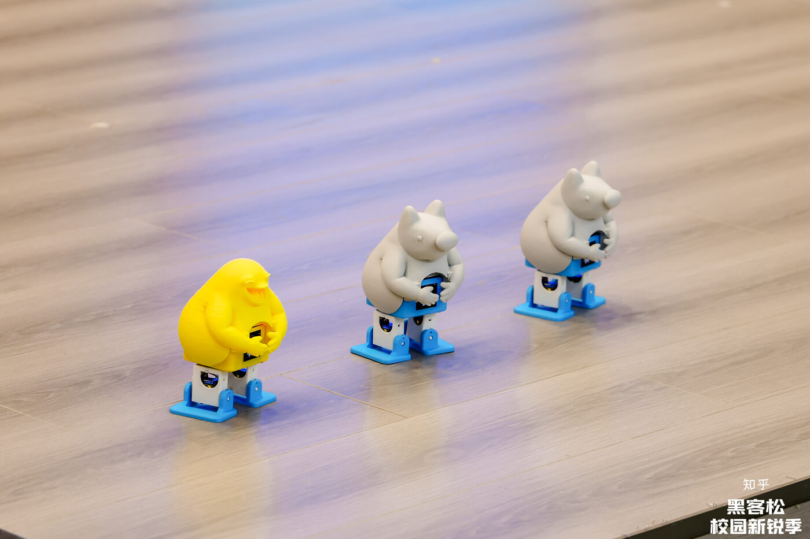
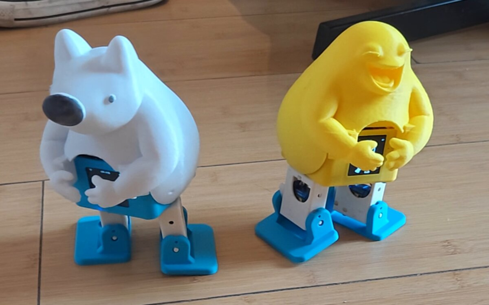
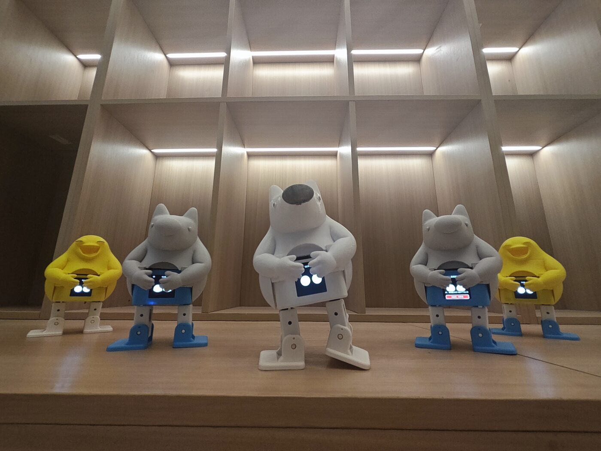
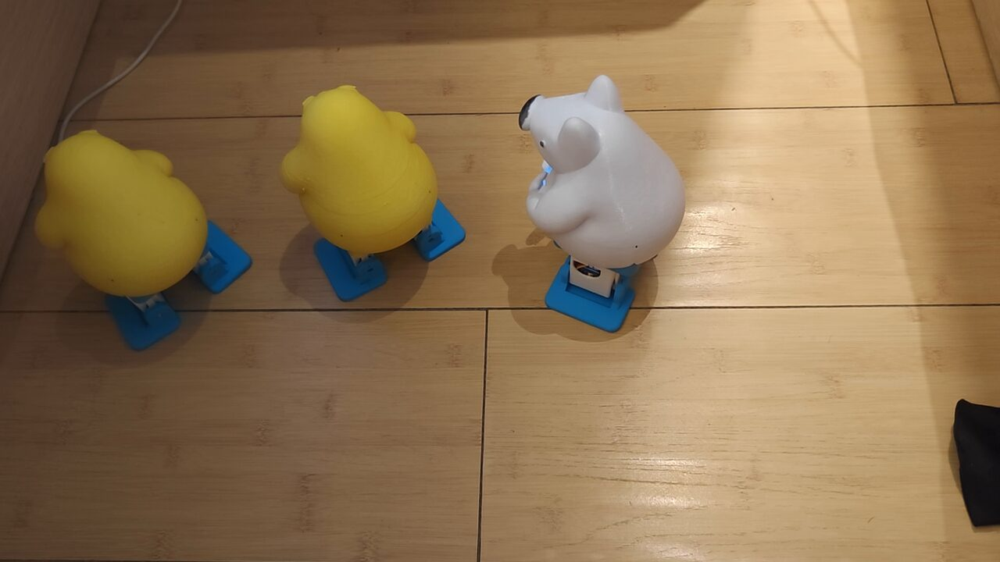
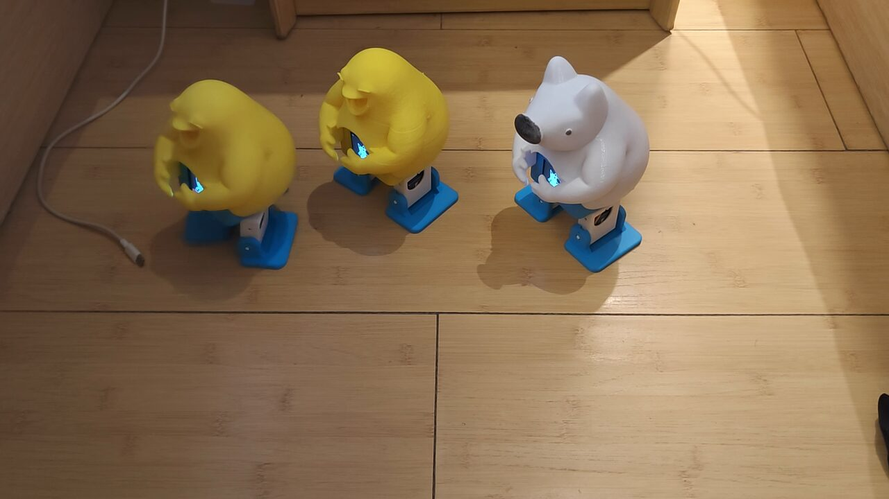

<h1 align="center">NailongBot</h1>

<p align="center">亲手组装、烧录和调试一只会说话、会走路的桌面 AI 伙伴。</p>

<p align="center">
  <a href="https://nailong.nekokax.com/">在线阅读</a> ·
  <a href="https://nailong.nekokax.com/docs/intro/path">学习路线</a> ·
  <a href="https://nailong.nekokax.com/docs/assembly/print">模型下载</a> ·
  <a href="https://github.com/lucklyduck/nailongBotWiki/issues">问题反馈</a>
</p>

<p align="center">
  
  <br />
  <sub>黄色奶龙与灰白色看山，使用同一套 Otto 双足结构。</sub>
</p>

## 🎯 项目介绍

奶龙机器人实战课围绕一台基于 **ESP32-S3 与小智 AI Otto** 的桌面机器人展开。你可以跟着教程认识零部件、打印外壳、完成组装，再进行固件烧录、配网、舵机校准和语音交互配置。有开发基础的同学，还可以继续添加动作、修改表情和唤醒词，尝试通过 MCP 让大模型调用机器人的功能。

课程记录的实物作品由 **知造 ZhiForge（catnipent）** 团队在 2026 知乎黑客松 · 校园新锐季制作。团队在 Otto 双足机器人的基础上加入奶龙 / 看山造型外壳，并在定制固件中加入“你好奶龙”唤醒词、看山表情和奶龙大笑等功能。

本仓库提供课程文档、网站源码、图片和演示视频，以及完整结构件模型（8 个 STL 与 1 个 3MF 参考工程）。课程目前有 **8 个章节、45 篇文档**，你可以按学习路线完成一台机器人，也可以按问题查阅组装、烧录和调试页面。

### 适合谁学习

- **第一次接触 DIY 机器人的同学**：从零部件和装配步骤开始，使用套件路线学习。
- **对智能硬件和 AI 交互感兴趣的同学**：了解语音、屏幕、舵机与对话后台如何配合。
- **希望继续改造机器人的开发者**：具备一些 C++ 和 Git 基础后，进入固件与 MCP 二次开发。

具体前置要求见[学前须知](https://nailong.nekokax.com/docs/intro/path)。课程提供配套零部件套装，清单和工具要求见[物料与工具](https://nailong.nekokax.com/docs/assembly/prepare)。

## ✨ 教程亮点

- **从装配到交互**：按外壳打印、舵机归中、整机组装、烧录、配网和设备绑定的顺序学习，每一步都有对应文档。
- **带着完成目标学习**：Task 0—5 列出阅读入口和完成标志，方便分阶段检查自己的进度。
- **用照片和视频辅助操作**：结合样机照片、结构示意图、演示视频与组装参考资料，观察零件位置和动作效果。
- **做出自己的角色**：配置人设、音色和模型；使用定制固件时，进一步修改动作、表情、声音和唤醒词。
- **保留排错入口**：串口日志、舵机校准、配网问题和 FAQ 分页整理，便于边做边查。

## 🔍 效果展示

<table>
  <tr>
    <td width="50%" align="center">
      
      <br />
      <strong>奶龙与看山两种外壳</strong>
      <br />
      <sub>用不同造型和配色制作自己的桌面伙伴。</sub>
    </td>
    <td width="50%" align="center">
      
      <br />
      <strong>屏幕与表情</strong>
      <br />
      <sub>观察样机亮屏后的表情与显示效果。</sub>
    </td>
  </tr>
  <tr>
    <td width="50%" align="center">
      <a href="https://nailong.nekokax.com/video/walk-three-back.mp4">
        
      </a>
      <br />
      <strong>双足行走演示</strong>
      <br />
      <sub>点击图片观看样机行走视频。</sub>
    </td>
    <td width="50%" align="center">
      <a href="https://nailong.nekokax.com/video/three-lit.mp4">
        
      </a>
      <br />
      <strong>样机亮屏演示</strong>
      <br />
      <sub>点击图片查看实机效果。</sub>
    </td>
  </tr>
</table>

更多功能和系统框图见[产品介绍](https://nailong.nekokax.com/docs/intro)。

## 📖 内容导航

| 章节 | 学习内容 | 在线阅读 | 文档源码 |
| --- | --- | --- | --- |
| 第一章 · 产品介绍 | 项目背景、规格、部件与引脚、功能状态、学习路线 | [阅读](https://nailong.nekokax.com/docs/intro) | [5 篇](source/docs/01-intro/) |
| 第二章 · 组装 | 物料、外壳打印、焊接、舵机归中、腿脚和主板装配、自检 | [阅读](https://nailong.nekokax.com/docs/assembly) | [8 篇](source/docs/02-assembly/) |
| 第三章 · 烧录 | 在线烧录、工具烧录、源码编译、固件合并 | [阅读](https://nailong.nekokax.com/docs/flash) | [5 篇](source/docs/03-flash/) |
| 第四章 · 调试 | 串口日志、配网、舵机校准、声音与 Otto Master | [阅读](https://nailong.nekokax.com/docs/debug) | [6 篇](source/docs/04-debug/) |
| 第五章 · xiaozhi 后台 | 登录、绑定设备、人设与音色、MCP 接入 | [阅读](https://nailong.nekokax.com/docs/xiaozhi) | [5 篇](source/docs/05-xiaozhi/) |
| 第六章 · 二次开发 | 固件结构、动作、MCP 工具、唤醒词、表情、音效、服务端与原理 | [阅读](https://nailong.nekokax.com/docs/dev) | [11 篇](source/docs/06-dev/) |
| 第七章 · FAQ | 项目、组装、烧录、网络与使用中的常见问题 | [阅读](https://nailong.nekokax.com/docs/faq) | [1 篇](source/docs/07-faq/) |
| 第八章 · 下载与分享 | 固件和工具入口、更新日志、联系与作品分享 | [阅读](https://nailong.nekokax.com/docs/download) | [4 篇](source/docs/08-download/) |

### 按 Task 0—5 开始实践

| 任务 | 要做什么 | 完成目标 |
| --- | --- | --- |
| Task 0 · 学前准备 | 认识机器人，选择套件或自行焊接路线 | 明确所需零件、工具和前置知识 |
| Task 1 · 把奶龙装起来 | 归中舵机，装配腿脚、主板和外壳 | 完成装配并检查舵机与站姿 |
| Task 2 · 让它亮起来 | 选择对应固件，完成烧录 | 屏幕亮起并显示表情 |
| Task 3 · 站直、会说话 | 配网、绑定设备、校准舵机 | 能对话，并能按指令完成动作 |
| Task 4 · 配置角色 | 设置人设、音色和交互方式 | 机器人按设定的角色回应 |
| Task 5 · 增加新本领 | 选做动作、表情、声音或 MCP 扩展 | 完成并验证一项自己的修改 |

步骤与验收说明见[完整学习路线](https://nailong.nekokax.com/docs/intro/path)。

## 🗺️ 已提供内容与下一步规划

### 已提供

- 8 章课程文档，以及配套图片、示意图和演示视频。
- 完整模型包（2026-11-13）：[本站 ZIP 下载](https://nailong.nekokax.com/downloads/models/2026-11-13/nailong-models-20261113.zip) · [单件清单与打印说明](https://nailong.nekokax.com/docs/assembly/print) · [仓库文件](source/static/downloads/models/2026-11-13/)。8 个 STL 各打印 1 件；3MF 仅含外壳、底座与左右卡销四个对象，不应重复打印。
- [在线 Wiki](https://nailong.nekokax.com/)，支持目录导航和站内搜索。
- 基于 Docusaurus 的网站源码与当前发布文件，支持本地预览和修改。

### 后续完善方向

- 根据学习者反馈补充装配照片、操作说明与故障排查案例。
- 补齐下载页中尚未提供的奶龙定制固件合并镜像及校验信息。
- 收集不同配色、动作和交互方案，整理可复现的二次开发案例。

课程部分页面仍有待核实或待补充内容，阅读时请以对应页面的说明为准。欢迎在 Issue 中提供实测记录、环境信息和修正建议。

## 💻 本地阅读与网站开发

只阅读课程可以直接打开[在线 Wiki](https://nailong.nekokax.com/)。修改文档或 UI 时，先准备 **Node.js 20 或以上版本**；当前网站已在 Node.js 24 下构建通过。

```bash
git clone https://github.com/lucklyduck/nailongBotWiki.git
cd nailongBotWiki/source
npm ci
npm run start
```

在浏览器打开终端输出的本地地址。生产构建与预览：

```bash
npm run build
npm run serve
```

主要编辑入口：

```text
nailongBotWiki/
├── README.md                  # 项目与课程入口
├── source/
│   ├── docs/                  # 八章课程正文
│   ├── src/                   # 首页、组件和样式
│   ├── static/                # 图片、视频、STL 等资源
│   ├── docusaurus.config.js   # 导航、页脚、站点地址等配置
│   ├── sidebars.js            # 文档侧边栏
│   └── package.json           # 开发与构建命令
└── site/                      # 当前发布的静态网站文件
```

线上网站由 Cloudflare Workers 托管，并关联本仓库。修改 `source/` 后，请先构建并检查结果，再将 `source/build/` 中的内容同步到 `site/`，随源码一起提交，保持阅读站与课程正文一致。`node_modules/` 和 `source/build/` 不需要提交。

## 🤝 如何贡献

欢迎通过 [Issue](https://github.com/lucklyduck/nailongBotWiki/issues) 或 [Pull Request](https://github.com/lucklyduck/nailongBotWiki/pulls) 参与：

- **修正文档**：错别字、失效链接、步骤遗漏、图片或参数说明。
- **反馈实际问题**：说明所用主板、固件版本、操作步骤，附上日志或照片。
- **改善阅读体验**：导航、搜索、排版、手机浏览和图片说明。
- **分享实践**：外壳配色、动作设计、MCP 工具或自己的装配记录。

改动正文时，请编辑 `source/docs/` 中对应的 Markdown 文件。修改 UI 时，编辑 `source/src/`。提交前运行 `npm run build`，确认构建通过，并在 PR 中说明改了什么、怎样验证。大幅调整章节或增加新的实践方向，可以先开 Issue 讨论。

## 🙏 致谢与资料来源

| 项目 / 团队 | 本课程中的关联 |
| --- | --- |
| 知造 ZhiForge（catnipent） | 奶龙 / 看山样机制作与黑客松实践 |
| [小智 AI · xiaozhi-esp32](https://github.com/78/xiaozhi-esp32) | 对话固件基础与源码参考 |
| [ottoRobot · txp666](https://github.com/txp666/ottodiy-docs) | 机器人结构、PCB 和相关资料 |
| [ESP-IDF](https://github.com/espressif/esp-idf) | ESP32 嵌入式开发、编译与烧录框架 |
| [ottodiy.tech](https://ottodiy.tech/docs/downloads/) | 组装、焊接、烧录等参考教程 |
| [Hello-Robot](https://github.com/datawhalechina/hello-robot) | README 信息结构参考 |

第三方图片与资料的出处见对应页面图注和[资料整理](source/sources.md)。本仓库目前未设置独立的项目许可证；上游固件、PCB 与第三方素材的许可说明请查阅各自项目。

感谢提供问题反馈、实测记录和内容修正的参与者。
