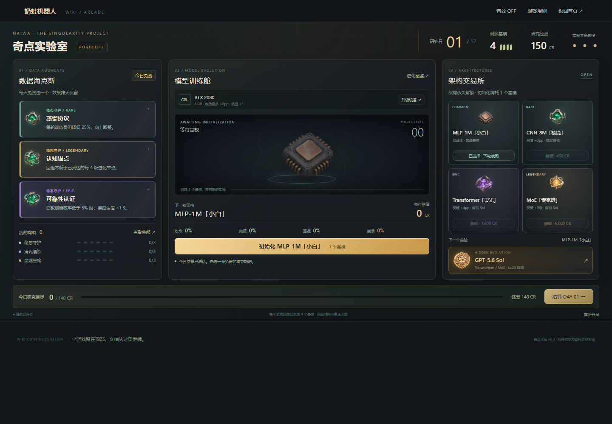

# 奶蛙 · 奇点实验室

一个可以嵌入 Wiki 首页顶部的 AI 模型训练肉鸽小游戏。准备数据海克斯、分配每日基模、训练并交付模型，在十二个研究日内构筑自己的升级路线。

**当前版本：v0.3.0。** 纯 HTML/CSS/JavaScript；无后端、无 npm 依赖、无真实 AI 调用，不需要 API Key。游戏存档保存在当前浏览器。



## 快速开始

解压交付包后，直接双击 `standalone/index.html` 即可离线试玩。

开发环境使用 Node.js 20 或以上。在项目根目录执行：

```sh
npm run check
npm test
npm run build
npm start
```

打开终端打印的本地地址。没有依赖，无需先运行 `npm install`。直接从 GitHub 克隆后先构建；`dist/` 和 `standalone/` 是生成目录，不提交 Git。

## 核心玩法

- 每个游戏日发放 4 个基模，初始化任意已购架构消耗 1 个；剩余基模在日末清空。
- 每日一张免费海克斯，额外选择依次消耗 1、2、3 个基模。30 张卡分为稳态、涌现、回收三条路线，有 3/6 件协同。
- 海克斯、显卡和架构许可跨天保留；**本局永久，重新开局清空**。
- 每次训练可能收敛、突破、回退或崩溃。Lv.0–24 各有实体贴图，每 4 级触发进化。
- 每日研究贡献目标逐步增长。未达标强行结算损失稳定度，归零失败；完成 12 天可继续无尽模式。
- 普通基模为 MLP-1M「小白」；CNN、Transformer、MoE 提供不同玩法。GPT-5.6 Sol 是虚构进化彩蛋。

规则细节见 [游戏设计](docs/GAME_DESIGN.md)，源代码入口是 `src/engine.js`。

## 加入 Wiki

你的 Wiki 项目使用 Docusaurus。推荐把 `dist/` 的内容复制到 Wiki 的 `static/games/naiwa-lab/`，再用包内 React 组件包裹现有首页 hero。

**逐步接入步骤： [WIKI_INTEGRATION.md](docs/WIKI_INTEGRATION.md)**

组件支持点击展开、返回原首页和 iframe 自适应高度；原有 Wiki 导航、文档和其他内容放在组件外。`mascotSrc` 可传入最终的奶蛙 Q 版图片；未传时显示“点一下试试”气泡按钮。包内没有新增最终奶蛙角色美术。

## 上传 GitHub

在 GitHub 新建空仓库后，在此目录执行（把示例地址替换成自己的仓库）：

```sh
git init
git add .
git commit -m "Add Naiwa Singularity Lab v0.3.0"
git branch -M main
git remote add origin https://github.com/YOUR_ACCOUNT/YOUR_REPOSITORY.git
git push -u origin main
```

若目标是已有 Wiki 仓库，可将此项目放到 `games-source/naiwa-lab/`，按接入文档将构建输出同步到 Wiki 的静态目录。只复制到子目录时，内部 `.github/workflows` 不会被 GitHub 自动执行；可将检查任务合并到 Wiki 仓库根目录的工作流。

`check.yml` 会在 push / PR 上检查构建和规则测试。可选的 `pages.yml` 仅手动触发，将游戏作为独立预览站发布，不会修改你的 Wiki。

需要独立预览站时，在仓库 **Settings → Pages → Source** 选择 **GitHub Actions**，再在 **Actions** 中选择 Pages 工作流，点击 **Run workflow**。完成后从工作流的部署环境打开预览地址。步骤依据 [GitHub Pages 自定义工作流文档](https://docs.github.com/en/pages/getting-started-with-github-pages/using-custom-workflows-with-github-pages)。

## 目录

```text
src/                   页面、样式、状态规则、交互及嵌入桥接
assets/images/         25级实体图集、Sol贴图、Logo、提示词及来源
assets/audio/          6种WAV音效、CC0许可及来源清单
scripts/               无依赖构建和本地预览
tests/                 规则、打包及可选浏览器嵌入测试
integration/           Docusaurus组件、普通HTML接入示例
docs/                  接入、玩法、维护说明及截图
.github/workflows/     CI检查及手动Pages发布
dist/                  构建生成：多文件静态网站
standalone/            构建生成：离线单HTML
```

## 素材与许可

素材不是统一许可。音效来自 Kenney（CC0）；模型实体由内置 ImageGen 生成；OpenAI 标志来自官方品牌包，归 OpenAI 所有并适用品牌条款。见 [THIRD_PARTY_NOTICES.md](THIRD_PARTY_NOTICES.md)。

本源码包没有代替项目所有者选择开源许可证。上传公开仓库不等于授予他人 MIT 等许可；若你决定开源，可在仓库添加你选定的代码许可证，同时保留独立素材声明。

## 当前范围

当前是单机原型，经济难度偏入门。没有账号、云存档、排行榜或反作弊；前端存档可被玩家修改。旧版 v0.1/v0.2 存档不迁移。完整验证范围见 [维护说明](docs/DEVELOPMENT.md)。
